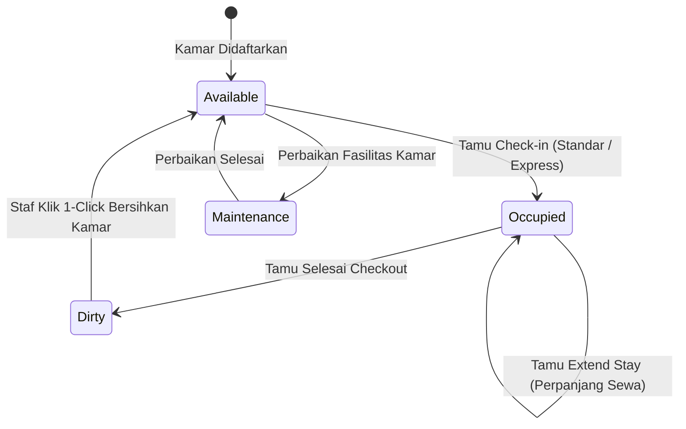
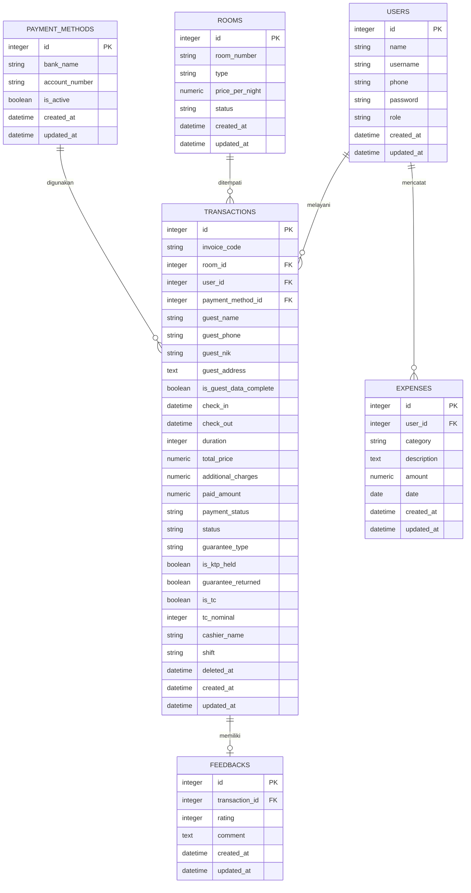

# DOKUMEN SPESIFIKASI KEBUTUHAN PERANGKAT LUNAK
## (SOFTWARE REQUIREMENTS SPECIFICATION - SRS)
### SISTEM INFORMASI MANAJEMEN FRONT OFFICE HOTEL NUANSA

---

## DAFTAR ISI
1. [BAB I: PENDAHULUAN](#bab-i-pendahuluan)
   - 1.1 [Tujuan Dokumen](#11-tujuan-dokumen)
   - 1.2 [Ruang Lingkup Sistem](#12-ruang-lingkup-sistem)
   - 1.3 [Definisi, Singkatan, dan Akronim](#13-definisi-singkatan-dan-akronim)
2. [BAB II: DESKRIPSI UMUM SISTEM](#bab-ii-deskripsi-umum-sistem)
   - 2.1 [Perspektif Produk](#21-perspektif-produk)
   - 2.2 [Karakteristik Pengguna & Hak Akses](#22-karakteristik-pengguna--hak-akses)
   - 2.3 [Batasan & Asumsi](#23-batasan--asumsi)
3. [BAB III: KEBUTUHAN FUNGSIONAL SISTEM (FUNCTIONAL REQUIREMENTS)](#bab-iii-kebutuhan-fungsional-sistem)
   - 3.1 [Modul Autentikasi & Manajemen Staf](#31-modul-autentikasi--manajemen-staf)
   - 3.2 [Modul Dashboard Monitoring Eksekutif](#32-modul-dashboard-monitoring-eksekutif)
   - 3.3 [Modul Front Office: Registrasi & Check-in](#33-modul-front-office-registrasi--check-in)
   - 3.4 [Modul Front Office: Checkout Cepat & Extend Stay](#34-modul-front-office-checkout-cepat--extend-stay)
   - 3.5 [Modul Smart Alert & Sistem Peringatan Dini](#35-modul-smart-alert--sistem-peringatan-dini)
   - 3.6 [Modul Buku Tamu Digital](#36-modul-buku-tamu-digital)
   - 3.7 [Modul Manajemen Kamar & Housekeeping](#37-modul-manajemen-kamar--housekeeping)
   - 3.8 [Modul Pengeluaran Operasional](#38-modul-pengeluaran-operasional)
   - 3.9 [Modul Laporan, Rekapitulasi & Ekspor Dokumen](#39-modul-laporan-rekapitulasi--ekspor-dokumen)
4. [BAB IV: KEBUTUHAN NON-FUNGSIONAL (NON-FUNCTIONAL REQUIREMENTS)](#bab-iv-kebutuhan-non-fungsional)
   - 4.1 [Kinerja & Kecepatan (Performance)](#41-kinerja--kecepatan)
   - 4.2 [Keamanan Sistem (Security)](#42-keamanan-sistem)
   - 4.3 [Keandalan & Integritas Data (Reliability)](#43-keandalan--integritas-data)
   - 4.4 [Usabilitas & Desain Antarmuka (Usability & Design System)](#44-usabilitas--desain-antarmuka)
5. [BAB V: SPESIFIKASI TEKNIKAL & ARSITEKTUR](#bab-v-spesifikasi-teknikal--arsitektur)
   - 5.1 [Daftar Teknologi (Technology Stack)](#51-daftar-teknologi-technology-stack)
   - 5.2 [Diagram Alur Status Kamar (State Diagram)](#52-diagram-alur-status-kamar)
   - 5.3 [Peta Rute & Titik Akhir API / Web (Routing Map)](#53-peta-rute--titik-akhir-api--web)
6. [BAB VI: PERANCANGAN BASIS DATA (DATABASE SCHEMA & DATA DICTIONARY)](#bab-vi-perancangan-basis-data)
   - 6.1 [Entity Relationship Diagram (ERD)](#61-entity-relationship-diagram-erd)
   - 6.2 [Kamus Data Lengkap (Data Dictionary)](#62-kamus-data-lengkap)

---

## BAB I: PENDAHULUAN

### 1.1 Tujuan Dokumen
Dokumen Spesifikasi Kebutuhan Perangkat Lunak (*Software Requirements Specification* - SRS) ini bertujuan untuk mendeskripsikan secara menyeluruh kebutuhan fungsional, non-fungsional, arsitektur teknis, dan struktur basis data dari aplikasi **Sistem Informasi Manajemen Front Office Hotel Nuansa**. Dokumen ini ditujukan sebagai panduan resmi bagi pengembang, penguji sistem, analis sistem, manajemen hotel, serta pemangku kepentingan akademik/profesional dalam evaluasi dan penyusunan laporan teknis.

### 1.2 Ruang Lingkup Sistem
Aplikasi Hotel Nuansa merupakan sistem *Property Management System* (PMS) berbasis web yang dirancang untuk mengotomatisasi operasional meja depan (*front desk*), tata graha (*housekeeping*), serta pembukuan keuangan harian hotel. Ruang lingkup sistem meliputi:
1. Registrasi tamu menginap (Check-in Standar & Express Check-in).
2. Penyelesaian transaksi dan kasir (Fast Checkout, penghitungan denda/biaya tambahan, konfirmasi pengembalian jaminan identitas).
3. Pemantauan status kamar interaktif secara *real-time* (Available, Occupied, Dirty, Maintenance).
4. Sistem peringatan dini cerdas (Deteksi batas waktu checkout 12:00 WIB dan tamu yang belum melengkapi NIK identitas).
5. Pendataan buku tamu digital (*Digital Guest Book*).
6. Pengelolaan pengeluaran kas operasional hotel.
7. Pelaporan keuangan komprehensif (Laba Kotor, Pengeluaran, Komisi TC, dan Estimasi Laba Bersih) beserta ekspor cetak PDF dan Excel.

### 1.3 Definisi, Singkatan, dan Akronim
* **PMS (*Property Management System*)**: Sistem komputerisasi terpadu untuk mengelola reservasi dan operasional hotel.
* **Express Check-in**: Prosedur penerimaan tamu cepat (1-klik) dengan pengisian identitas sementara untuk memangkas waktu tunggu saat antrean padat.
* **TC (*Travel / Calo*)**: Pihak ketiga, agen perjalanan, supir taksi/travel yang mengantar tamu ke hotel dan berhak memperoleh komisi rujukan.
* **RBAC (*Role-Based Access Control*)**: Mekanisme pengaturan hak akses sistem berdasarkan peran kerja pengguna (Admin vs Kasir).
* **Housekeeping**: Proses pembersihan dan perawatan kamar setelah digunakan tamu (*Dirty* berubah kembali menjadi *Available*).
* **Overdue Checkout**: Kondisi kamar aktif yang melewati batas jam checkout resmi hotel (standar 12:00 WIB).

---

## BAB II: DESKRIPSI UMUM SISTEM

### 2.1 Perspektif Produk
Hotel Nuansa Front Office System adalah aplikasi web *independent & self-contained* yang beroperasi pada jaringan lokal (*intranet*) maupun *cloud server*. Sistem ini menggantikan pencatatan buku besar fisik manual dengan basis data terenkripsi dan antarmuka web modern, terintegrasi langsung antara Front Office, Resepsionis, Housekeeping, dan Pemilik Hotel.

### 2.2 Karakteristik Pengguna & Hak Akses
Sistem mengidentifikasi 2 (dua) tipe aktor/peran:

| Peran (Role) | Tanggung Jawab Operasional | Hak Akses Fitur |
|---|---|---|
| **Admin (Manajemen/Owner)** | Bertanggung jawab atas kebijakan harga, pengawasan staf, audit keuangan, dan inventaris kamar. | Akses penuh: Dashboard Keuangan, Front Office, Manajemen Kamar, Manajemen Pengeluaran, Laporan Laba Rugi, Ekspor PDF/Excel, dan Manajemen Staf/Pengguna. |
| **Kasir / Resepsionis** | Bertanggung jawab atas pelayanan tamu di meja depan, penerimaan pembayaran, dan serah terima shift. | Akses operasional: Front Office (Check-in & Checkout), Buku Tamu Digital, Riwayat Transaksi, Housekeeping Kamar, dan Rekap Shift Personal Kasir. |

### 2.3 Batasan & Asumsi
1. Jam checkout standar hotel ditentukan pukul **12:00 WIB**.
2. Pergantian shift kasir dibagi menjadi 2 (dua) siklus:
   - **Shift Pagi**: 07:00 – 19:00 WIB.
   - **Shift Malam**: 19:00 – 07:00 WIB.
3. Transaksi kamar yang sedang aktif (*Occupied*) tidak dapat dihapus (*protected data integrity*) dan kamar tidak dapat diubah statusnya menjadi *Available* sebelum proses checkout diselesaikan.

---

## BAB III: KEBUTUHAN FUNGSIONAL SISTEM

### 3.1 Modul Autentikasi & Manajemen Staf
* **FR-01 (Login Akun)**: Pengguna dapat masuk ke sistem menggunakan kombinasi No. HP / Username terdaftar dan Password.
* **FR-02 (Show/Hide Password)**: Antarmuka menyediakan tombol intip kata sandi untuk mencegah kesalahan pengetikan kredensial.
* **FR-03 (Manajemen Pengguna - Admin Only)**: Admin dapat mendaftarkan akun staf baru, mengubah identitas (nama, nomor handphone, role), serta menghapus akun staf.
* **FR-04 (Proteksi Sesi & Logout)**: Sistem mengamankan sesi pengguna dengan token CSRF dan middleware autentikasi, serta menyediakan fitur keluar sesi (*logout*).

### 3.2 Modul Dashboard Monitoring Eksekutif
* **FR-05 (Gauge Okupansi Otomatis)**: Sistem menghitung dan menampilkan persentase okupansi kamar secara *real-time* dalam bentuk diagram donat (*donut chart*).
* **FR-06 (Statistik Finansial Bulanan)**: Menampilkan 4 kartu KPI utama: Total Pendapatan Bulan Ini, Total Pengeluaran Bulan Ini, Total Komisi TC, dan Estimasi Laba Bersih.
* **FR-07 (Tren Omset 7 Hari)**: Visualisasi grafik batang interaktif yang menampilkan volume pendapatan kotor per hari selama 7 hari terakhir.
* **FR-08 (Daftar Tamu Menginap Aktif)**: Menampilkan daftar kamar yang sedang terisi beserta nama tamu, durasi, status pembayaran tagihan (*Paid / Partial / Unpaid*), dan status kelengkapan data.
* **FR-09 (Denah Kamar Interaktif)**: Grid denah kamar dengan status visual (Available, Occupied, Dirty, Maintenance).

### 3.3 Modul Front Office: Registrasi & Check-in
* **FR-10 (Check-in Standar)**: Resepsionis dapat memilih kamar kosong, mengisi data tamu, menentukan durasi malam menginap, serta memilih metode pembayaran.
* **FR-11 (Express Check-in 1-Klik)**: Menyediakan tombol registrasi kilat yang otomatis mengisi nama default (`GUEST ROOM [No Kamar]`) dan menandai data tamu berstatus belum lengkap (`is_guest_data_complete = false`).
* **FR-12 (Multi-Metode Pembayaran)**: Mendukung transaksi Tunai (*Cash*), Transfer Bank BCA, Transfer Bank Mandiri, dan QRIS.
* **FR-13 (Pengelolaan Jaminan Identitas)**: Opsi pencatatan tipe fisik jaminan (KTP, SIM, STNK) dan penanda jaminan ditahan di resepsionis.
* **FR-14 (Komisi TC / Rekanan)**: Fasilitas mencatat nominal komisi bagi rekanan/supir yang mengantar tamu.

### 3.4 Modul Front Office: Checkout Cepat & Extend Stay
* **FR-15 (Fast Checkout)**: Resepsionis dapat menyelesaikan transaksi tamu dalam satu antarmuka terpadu (*side-by-side*).
* **FR-16 (Kalkulasi Biaya Tambahan)**: Input dinamis untuk biaya overtime (keterlambatan), minibar, laundry, atau kerusakan fasilitas kamar.
* **FR-17 (Metode Pelunasan Checkout)**: Kasir dapat memilih metode pembayaran pelunasan saat checkout jika berbeda dari saat check-in awal.
* **FR-18 (Konfirmasi Pengembalian Jaminan)**: Sistem memvalidasi secara ketat bahwa jaminan fisik KTP/SIM telah diserahkan kembali kepada tamu sebelum transaksi dapat diselesaikan.
* **FR-19 (Extend Stay)**: Menambah durasi menginap tamu secara instan yang otomatis mengkalkulasi ulang total tagihan dan tanggal rencana checkout.

### 3.5 Modul Smart Alert & Sistem Peringatan Dini
* **FR-20 (Checkout Timing Urgency)**:
  - **Status Overdue (Merah Menyala)**: Alert berdenyut jika tamu melewati pukul 12:00 WIB disertai teks selisih waktu keterlambatan (contoh: *Lewat 45 mnt*).
  - **Status Imminent (Kuning Amber)**: Peringatan jika waktu checkout tersisa kurang dari 2 jam (contoh: *Sisa 30 mnt*).
  - **Status Today (Biru)**: Penanda bahwa jadwal checkout kamar jatuh pada hari ini.
* **FR-21 (Top Alert Banner Checkout)**: Banner peringatan prioritas tinggi di bagian atas Dashboard dan Front Office jika ada kamar yang mendekati/melewati jam checkout.
* **FR-22 (Incomplete Guest Alert)**: Peringatan visual pada kamar hasil Express Check-in yang belum memiliki NIK identitas.
* **FR-23 (Peringatan Checkout Modal)**: Modal pop-up checkout menampilkan status peringatan keterlambatan dan peringatan jika data identitas belum lengkap sebelum tombol konfirmasi ditekan.

### 3.6 Modul Buku Tamu Digital
* **FR-24 (Formulir Identitas Tamu)**: Pencatatan NIK 16 digit KTP, No. WhatsApp/Handphone, dan Alamat Asal tamu.
* **FR-25 (Koreksi Nama Tamu)**: Mengubah nama sementara Express (`GUEST ROOM 101`) menjadi nama asli tamu sesuai KTP.
* **FR-26 (Verifikasi Administrasi)**: Menandai transaksi menjadi `is_guest_data_complete = true` saat data berhasil disimpan.

### 3.7 Modul Manajemen Kamar & Housekeeping
* **FR-27 (Inventaris Kamar)**: Admin dapat menambah, memperbarui nomor kamar, tipe kamar, dan tarif sewa per malam.
* **FR-28 (1-Click Mark Clean)**: Staf kebersihan/kasir dapat mengubah status kamar *Dirty* menjadi *Available* dengan 1 klik tombol.
* **FR-29 (Integritas Operasional)**: Sistem mencegah penghapusan atau perubahan status kamar yang sedang aktif dihuni tamu.

### 3.8 Modul Pengeluaran Operasional
* **FR-30 (Pencatatan Kas Keluar)**: Pencatatan beban pengeluaran operasional (Kategori: Utilities, Maintenance, Supplies, Operasional Lainnya).
* **FR-31 (Histori Pengeluaran)**: Riwayat kas keluar dengan filter berdasarkan kategori dan rentang tanggal.
* **FR-32 (Integrasi Laba Bersih)**: Pengeluaran operasional otomatis memotong omset pendapatan pada rekapitulasi laba rugi.

### 3.9 Modul Laporan, Rekapitulasi & Ekspor Dokumen
* **FR-33 (Laporan Keuangan Laba Rugi)**: Rekapitulasi laba kotor, beban operasional, komisi TC, dan laba bersih dengan filter periode (Harian, Mingguan, Bulanan, Tahunan).
* **FR-34 (Personal Shift Recap)**: Laporan penerimaan kas kasir yang bertugas pada shift aktif (`/my-recap`) untuk validasi serah terima uang fisik kasir.
* **FR-35 (Struk Thermal & Invoice)**: Mencetak struk bukti pembayaran resmi hotel berformat thermal/web.
* **FR-36 (Ekspor Dokumen PDF & Excel)**: Fasilitas unduh berkas laporan dan riwayat transaksi ke format **PDF** dan **Excel (.xlsx)**.

---

## BAB IV: KEBUTUHAN NON-FUNGSIONAL

### 4.1 Kinerja & Kecepatan
* Waktu respon pemuatan halaman (*page load time*) rata-rata di bawah 1,5 detik pada koneksi standar.
* Pemuatan modal checkout dan status kamar via AJAX responsif di bawah 500 milidetik.

### 4.2 Keamanan Sistem
* Enkripsi kata sandi menggunakan algoritma *Bcrypt / Argon2*.
* Perlindungan seluruh formulir HTTP POST/PUT menggunakan token **CSRF (Cross-Site Request Forgery)**.
* Sanitasi input pengguna untuk mencegah serangan **SQL Injection** dan **XSS (Cross-Site Scripting)**.
* Pembatasan hak akses rute menggunakan Laravel Route Middleware (`auth`, `role:admin`, `role:kasir`).

### 4.3 Keandalan & Integritas Data
* Menggunakan transaksi basis data (*Database Transactions - DB::beginTransaction & DB::commit*) pada alur kritis (Check-in, Checkout, Perpanjangan Sewa) untuk menjamin data tidak korup bila terjadi gangguan jaringan.
* Menggunakan mekanisme *Soft Deletes* pada data transaksi historis untuk memelihara jejak audit keuangan.

### 4.4 Usabilitas & Desain Antarmuka (Design System)
* **Desain Modern Terpadu**: Mengacu pada palet warna resmi Hotel Nuansa:
  - Latar Belakang: *Warm Cream* (`#F5EFE6`).
  - Bilah Navigasi / Sidebar: *Midnight Navy* (`#0B192C`).
  - Aksen Tombol / Badge Status: *Golden Amber* (`#F5A623`).
  - Kartu Metrik Keuangan: *Royal Blue* (`#1D58B8`).
* Tipografi menggunakan font modern berlisensi terbuka: **Plus Jakarta Sans**.
* Tata letak responsif penuh (*full responsive layout*) yang mendukung PC Desktop, Laptop kasir, Tablet, dan Smartphone.

---

## BAB V: SPESIFIKASI TEKNIKAL & ARSITEKTUR

### 5.1 Daftar Teknologi (Technology Stack)
* **Bahasa Pemrograman**: PHP 8.2+
* **Framework Backend**: Laravel 12.x (Arsitektur Model-View-Controller)
* **Framework Frontend**: Tailwind CSS 3.x, Alpine.js 3.x
* **Ikonografi & Tipografi**: FontAwesome 6 Pro/Free, Plus Jakarta Sans
* **Basis Data (Database Engine)**: SQLite (Development/Portable) / MySQL 8.0+ (Production Ready)
* **Pustaka Dokumen & Ekspor**:
  - `barryvdh/laravel-dompdf` (Pembangkit Dokumen PDF)
  - `maatwebsite/excel` (Pembangkit Dokumen Spreadsheet Excel .xlsx)

### 5.2 Diagram Alur Status Kamar (State Diagram)

### 5.3 Peta Rute & Titik Akhir API / Web

| Metode | URL Route | Nama Route | Hak Akses | Deskripsi Fungsi |
|---|---|---|---|---|
| `GET` | `/login` | `login` | Publik | Halaman form login akun |
| `POST` | `/login` | - | Publik | Autentikasi kredensial pengguna |
| `POST` | `/logout` | `logout` | Terautentikasi | Mengakhiri sesi pengguna |
| `GET` | `/dashboard` | `dashboard` | Terautentikasi | Halaman dashboard eksekutif & monitoring kamar |
| `GET` | `/front-office` | `front-office` | Terautentikasi | Halaman terpadu check-in dan checkout cepat |
| `GET` | `/checkin` | `checkin` | Terautentikasi | Alias navigasi langsung ke Front Office |
| `POST` | `/transactions/checkin/{room}` | `transactions.store` | Terautentikasi | Memproses transaksi check-in baru |
| `POST` | `/transactions/checkout/{id}` | `transactions.processCheckout` | Terautentikasi | Memproses penyelesaian transaksi checkout |
| `POST` | `/transactions/{id}/extend` | `transactions.extend` | Terautentikasi | Memproses perpanjangan durasi menginap |
| `GET` | `/transactions/{id}/checkout-data` | - | Terautentikasi | Endpoint AJAX data modal checkout |
| `GET` | `/transactions/{id}/guest-book` | `transactions.guestBook` | Terautentikasi | Form Buku Tamu Digital pelengkap identitas |
| `PUT` | `/transactions/{id}/update-guest-data` | `transactions.updateGuestData` | Terautentikasi | Menyimpan kelengkapan data tamu Express |
| `GET` | `/transactions` | `transactions.index` | Terautentikasi | Halaman tabel riwayat seluruh transaksi |
| `GET` | `/transactions/{id}` | `transactions.show` | Terautentikasi | Halaman rincian lengkap invoice transaksi |
| `GET` | `/transactions/struk/{id}` | `transactions.struk` | Terautentikasi | Cetak struk bukti pembayaran resmi hotel |
| `POST` | `/rooms/{id}/mark-clean` | `rooms.markClean` | Terautentikasi | Mengubah status kamar Dirty ➜ Available |
| `GET` | `/my-recap` | `recaps.personal` | Terautentikasi | Laporan rekapan uang tunai per shift kasir |
| `GET` | `/reports/finance` | `reports.finance` | Terautentikasi | Laporan laba rugi dan pembukuan finansial |
| `GET` | `/export/transactions/pdf` | `export.transactions.pdf` | Terautentikasi | Ekspor riwayat transaksi ke PDF |
| `GET` | `/export/transactions/excel` | `export.transactions.excel` | Terautentikasi | Ekspor riwayat transaksi ke Excel |
| `GET` | `/rooms` | `rooms.index` | Terautentikasi | Manajemen daftar dan tarif kamar |
| `GET` | `/expenses` | `expenses.index` | Terautentikasi | Manajemen dan pencatatan pengeluaran |
| `GET` | `/users` | `users.index` | Admin Only | Manajemen data staf dan kasir |

---

## BAB VI: PERANCANGAN BASIS DATA

### 6.1 Entity Relationship Diagram (ERD)

---

### 6.2 Kamus Data Lengkap (Data Dictionary)

#### 1. Tabel: `users`
Menyimpan data staf, kasir, dan administrator sistem.

| Nama Kolom | Tipe Data | Nullable | Nilai Default | Keterangan |
|---|---|---|---|---|
| `id` | INTEGER | No | Auto Increment | Kunci Utama (*Primary Key*) |
| `name` | VARCHAR(255) | No | - | Nama lengkap staf |
| `username` | VARCHAR(255) | Yes | NULL | ID / Username staf untuk login |
| `phone` | VARCHAR(50) | Yes | NULL | Nomor handphone staf untuk login |
| `password` | VARCHAR(255) | No | - | Kata sandi terenkripsi (Hash Bcrypt) |
| `role` | VARCHAR(50) | No | `'kasir'` | Peran pengguna: `'admin'` atau `'kasir'` |
| `remember_token` | VARCHAR(100) | Yes | NULL | Token sesi login otomatis |
| `created_at` | DATETIME | Yes | NULL | Waktu pembuatan akun |
| `updated_at` | DATETIME | Yes | NULL | Waktu pembaruan akun |

---

#### 2. Tabel: `rooms`
Menyimpan data inventaris fisik kamar hotel beserta status terkini.

| Nama Kolom | Tipe Data | Nullable | Nilai Default | Keterangan |
|---|---|---|---|---|
| `id` | INTEGER | No | Auto Increment | Kunci Utama (*Primary Key*) |
| `room_number` | VARCHAR(50) | No | - | Nomor identifikasi fisik kamar (misal: 101, 102) |
| `type` | VARCHAR(100) | No | - | Tipe kamar (Standard Kipas, Standard Plus, Deluxe AC, Suite AC+TV) |
| `price_per_night` | NUMERIC(12,2) | No | - | Tarif sewa kamar per malam (dalam Rupiah) |
| `status` | VARCHAR(50) | No | `'available'` | Status ketersediaan: `'available'`, `'occupied'`, `'dirty'`, `'maintenance'` |
| `created_at` | DATETIME | Yes | NULL | Waktu pendaftaran kamar |
| `updated_at` | DATETIME | Yes | NULL | Waktu pembaruan data kamar |

---

#### 3. Tabel: `transactions`
Menyimpan seluruh rekapan transaksi menginap (*Check-in, Checkout, Pembayaran, dan Jaminan*).

| Nama Kolom | Tipe Data | Nullable | Nilai Default | Keterangan |
|---|---|---|---|---|
| `id` | INTEGER | No | Auto Increment | Kunci Utama (*Primary Key*) |
| `invoice_code` | VARCHAR(50) | No | - | Kode unik transaksi (format: `INV-YYYYMMDD-XXX`) |
| `room_id` | INTEGER | No | - | Kunci Tamu ke tabel `rooms.id` |
| `user_id` | INTEGER | Yes | NULL | Kunci Tamu ke tabel `users.id` (Kasir yang membuat) |
| `payment_method_id` | INTEGER | Yes | NULL | Kunci Tamu ke tabel `payment_methods.id` |
| `guest_name` | VARCHAR(255) | No | - | Nama tamu (atau `GUEST ROOM [Nomor]` jika Express) |
| `guest_nik` | VARCHAR(50) | Yes | NULL | Nomor Induk Kependudukan (16 digit KTP) |
| `guest_phone` | VARCHAR(50) | Yes | NULL | Nomor kontak WhatsApp/Handphone tamu |
| `guest_address` | TEXT | Yes | NULL | Alamat asal tempat tinggal tamu |
| `is_guest_data_complete`| TINYINT(1) | No | `0` | Status verifikasi NIK (`1 = Lengkap`, `0 = Belum`) |
| `check_in` | DATETIME | No | - | Waktu dan tanggal check-in tamu |
| `check_out` | DATETIME | Yes | NULL | Waktu dan tanggal rencana/realisasi checkout |
| `duration` | INTEGER | No | `1` | Durasi masa menginap (dalam jumlah malam) |
| `total_price` | NUMERIC(14,2) | No | `0` | Total tagihan akhir (Harga kamar x Durasi + Biaya Tambahan) |
| `additional_charges` | NUMERIC(14,2) | No | `0` | Biaya tambahan (overtime, minibar, laundry, denda) |
| `paid_amount` | NUMERIC(14,2) | No | `0` | Jumlah uang tunai/transfer yang dibayarkan tamu |
| `payment_status` | VARCHAR(50) | No | `'unpaid'` | Status tagihan: `'paid'`, `'partial'`, `'unpaid'` |
| `status` | VARCHAR(50) | No | `'active'` | Status menginap: `'active'` (menginap), `'finished'` (selesai) |
| `guarantee_type` | VARCHAR(50) | Yes | NULL | Jenis jaminan identitas (`KTP`, `SIM`, `STNK`) |
| `is_ktp_held` | TINYINT(1) | No | `0` | Penanda fisik jaminan ditahan di resepsionis (`1/0`) |
| `guarantee_returned` | TINYINT(1) | No | `0` | Konfirmasi fisik jaminan sudah dikembalikan ke tamu (`1/0`) |
| `is_tc` | TINYINT(1) | No | `0` | Penanda transaksi melibatkan komisi travel/calo (`1/0`) |
| `tc_nominal` | INTEGER | No | `0` | Besaran komisi rekanan/calo (dalam Rupiah) |
| `cashier_name` | VARCHAR(100) | Yes | NULL | Nama petugas kasir yang memproses checkout |
| `shift` | VARCHAR(50) | Yes | NULL | Shift kerja saat transaksi diselesaikan (`'Pagi'` / `'Malam'`) |
| `deleted_at` | DATETIME | Yes | NULL | Penanda *Soft Delete* untuk arsip transaksi |
| `created_at` | DATETIME | Yes | NULL | Waktu pembuatan transaksi |
| `updated_at` | DATETIME | Yes | NULL | Waktu pembaruan transaksi |

---

#### 4. Tabel: `expenses`
Menyimpan data pengeluaran kas operasional hotel.

| Nama Kolom | Tipe Data | Nullable | Nilai Default | Keterangan |
|---|---|---|---|---|
| `id` | INTEGER | No | Auto Increment | Kunci Utama (*Primary Key*) |
| `user_id` | INTEGER | Yes | NULL | Kunci Tamu ke tabel `users.id` (pencatat beban) |
| `category` | VARCHAR(100) | No | - | Kategori beban: `Utilities`, `Maintenance`, `Supplies`, `Operasional` |
| `description` | TEXT | Yes | NULL | Keterangan rincian barang/jasa yang dibeli |
| `amount` | NUMERIC(14,2) | No | - | Nominal pengeluaran (dalam Rupiah) |
| `date` | DATE | No | - | Tanggal pengeluaran kas terjadi |
| `created_at` | DATETIME | Yes | NULL | Waktu pencatatan |
| `updated_at` | DATETIME | Yes | NULL | Waktu pembaruan |

---

#### 5. Tabel: `payment_methods`
Menyimpan saluran dan metode pembayaran yang diterima hotel.

| Nama Kolom | Tipe Data | Nullable | Nilai Default | Keterangan |
|---|---|---|---|---|
| `id` | INTEGER | No | Auto Increment | Kunci Utama (*Primary Key*) |
| `bank_name` | VARCHAR(100) | No | - | Nama metode: `Cash`, `Transfer BCA`, `Transfer Mandiri`, `QRIS` |
| `account_number` | VARCHAR(100) | Yes | NULL | Nomor rekening atau nomor identifikasi merchant |
| `is_active` | TINYINT(1) | No | `1` | Status keaktifan metode pembayaran (`1 = Aktif`, `0 = Nonaktif`) |
| `created_at` | DATETIME | Yes | NULL | Waktu penambahan metode |
| `updated_at` | DATETIME | Yes | NULL | Waktu pembaruan metode |

---

#### 6. Tabel: `feedbacks`
Menyimpan testimoni dan ulasan kepuasan tamu menginap.

| Nama Kolom | Tipe Data | Nullable | Nilai Default | Keterangan |
|---|---|---|---|---|
| `id` | INTEGER | No | Auto Increment | Kunci Utama (*Primary Key*) |
| `transaction_id`| INTEGER | No | - | Kunci Tamu ke tabel `transactions.id` |
| `rating` | INTEGER | No | - | Penilaian bintang kepuasan tamu (Skala 1 s/d 5) |
| `comment` | TEXT | Yes | NULL | Ulasan / komentar tertulis dari tamu |
| `created_at` | DATETIME | Yes | NULL | Waktu ulasan diberikan |
| `updated_at` | DATETIME | Yes | NULL | Waktu pembaruan ulasan |
